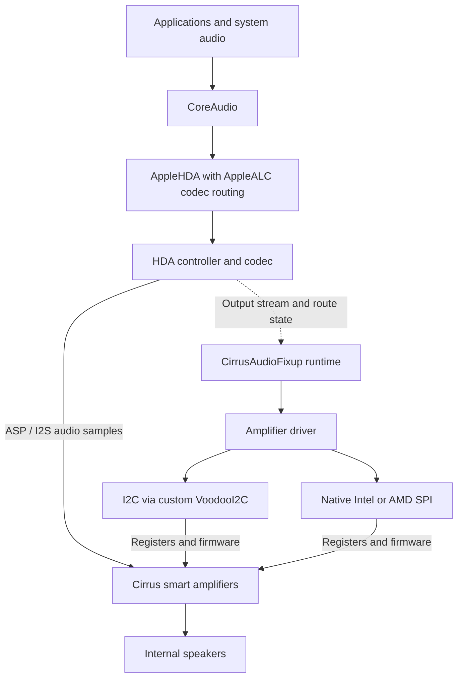

<div align="center">

# CirrusAudioFixup

**Cirrus Logic smart amplifier support for macOS.**

I2C and SPI - Intel and AMD - x86_64

[](https://github.com/hoaug-tran/CirrusAudioFixup/actions/workflows/build.yml)
[](https://github.com/hoaug-tran/CirrusAudioFixup/releases)
[](#macos-compatibility)
[](LICENSE)

[Download](https://github.com/hoaug-tran/CirrusAudioFixup/releases) · [Installation](#installation) · [Supported hardware](#supported-hardware) · [Troubleshooting](#troubleshooting) · [Build from source](#build-from-source)

</div>

> [!CAUTION]
> **First boot: add these boot arguments before loading the kext:**
>
> ```text
> -cirrusro -cirrusdbg
> ```
>
> Read-only mode skips amplifier writes, platform reset and playback. Follow the [first-boot checks](#4-first-boot-inspect-only) before removing `-cirrusro`. Keep a working backup EFI.
>
> Speaker tuning and boost must match the board. Leave `-cirrusnodsp` unset: it disables DSP speaker protection.

> [!WARNING]
> **Disclaimer:** Use at your own risk. The software is provided without warranty; the authors and copyright holders accept no liability for damage or data loss arising from its use. See [LICENSE](LICENSE).

CirrusAudioFixup enables internal speakers driven by Cirrus Logic smart amplifiers on macOS. It handles amplifier initialization, DSP firmware, speaker tuning, playback and sleep/wake over I2C or native SPI.

**CS35L41 is currently supported over I2C and SPI.** The driver framework allows support for additional Cirrus amplifier families; the [support table](#amplifier-families) lists their current status.

AppleHDA and AppleALC provide the codec route. CirrusAudioFixup manages the amplifiers on that route. Firmware and tuning are embedded in the kext, with no separate firmware installation or userspace service.

---

<details>
<summary><strong>Contents</strong></summary>

- [Supported hardware](#supported-hardware)
- [macOS compatibility](#macos-compatibility)
- [Sound compared with Windows](#sound-compared-with-windows)
- [Identify I2C or SPI](#identify-i2c-or-spi)
- [Requirements](#requirements)
- [Installation](#installation)
- [Update or remove](#update-or-remove)
- [How it works](#how-it-works)
- [Boot arguments](#boot-arguments)
- [Status and diagnostics](#status-and-diagnostics)
- [Troubleshooting](#troubleshooting)
- [Collect Windows or Linux data](#collect-windows-or-linux-data)
- [Adding hardware support](#adding-hardware-support)
- [Build from source](#build-from-source)
- [Documentation](#documentation)
- [Sources and acknowledgments](#sources-and-acknowledgments)
- [License](#license)

</details>

## Supported hardware

### Amplifier families

| Amplifier | Support status | Scope |
| --- | --- | --- |
| **CS35L41** | **Supported** | Revision B2; I2C and SPI; supported board profiles and matching firmware |
| CS35L45 | Not yet supported | Requires a dedicated amplifier driver |
| CS35L51 | Not yet supported | Requires a dedicated amplifier driver |
| CS35L56 | Not yet supported | Requires a dedicated amplifier driver |
| Other Cirrus amplifiers | Not yet supported | Additional families can use the shared framework |

Additional families need their own driver, board configuration and firmware.

### Working laptop configurations

| Laptop | Board identity | Bus | Status |
| --- | --- | --- | --- |
| **Lenovo Legion 7 16ACHg6 (2021)** | `17AA:3847` | I2C | **Working** |
| **Lenovo Legion 5 Pro 16ACH6H (2021)** | `17AA:382B` | I2C | **Working** |
| **HP ZBook Fury 16 G9** | `103C:89C6` | SPI | **Working** |

<details>
<summary><strong>Other boards and controller support</strong></summary>

| Configuration | Status |
| --- | --- |
| Other `CSC3551` boards | ACPI discovery available for supported properties; matching embedded firmware and board validation required |
| `CLSA0101` or an unknown legacy Lenovo identity | Automatic initialization disabled |
| Intel LPSS SPI | Supported SPT, BXT, CNL and TGL PCI profiles; controller identity selects the register family and root clock |
| AMD SPI | `AMDI0061` and `AMDI0062`, V1/V2 command controllers; mode 0 |
| SPI chip select | Native or supported GPIO-backed chip select, selected from firmware resources |
| SoundWire | Not supported |
| Apple silicon | Not supported |

Native SPI uses the built-in controller drivers and does **not** require VoodooI2C. I2C requires the addressed-transfer interface in the custom provider. Controller support alone does not establish that a laptop's speaker wiring and tuning are supported.

</details>

<details>
<summary><strong>Speakers, headphones and microphone</strong></summary>

| Endpoint | Responsible driver | Configuration notes |
| --- | --- | --- |
| Internal speakers | CirrusAudioFixup + host codec route | Working on the configurations listed above; DSP firmware and tuning are loaded by this kext |
| 3.5 mm headphones | AppleHDA + AppleALC | Jack routing and detection belong to the codec layout; CirrusAudioFixup follows the speaker-output state |
| Internal microphone | AppleHDA + AppleALC | Input routing and gain are configured by the codec driver |
| HDMI / DisplayPort audio | Host audio stack and GPU configuration | Independent of the internal speaker amplifier driver |

AppleALC must configure the actual speaker output path for the machine. A matching codec name or a visible audio device alone is not enough: the route must reach the codec output feeding the Cirrus amplifiers.

</details>

## macOS compatibility

| macOS | Status |
| --- | --- |
| Big Sur 11 | Minimum build deployment target |
| Monterey 12 | Within the deployment range; no confirmed test result listed here |
| **Ventura 13** | **Confirmed working** |
| **Sonoma 14** | Within the deployment range; no confirmed test result listed here |
| **Sequoia 15** | **Confirmed working** |
| Tahoe 26 | Requires a working host audio stack; no confirmed test result listed here |

Builds target **x86_64**. Confirmed OS support applies to the working hardware configurations, not every laptop containing a Cirrus amplifier.

### Tahoe: restore and validate the host audio stack first

CirrusAudioFixup needs an operational HDA controller and codec route. It does not install or restore AppleHDA. If the host audio stack is absent or incompatible, resolve that first; amplifier initialization cannot create the missing codec route. VoodooHDA combinations are not validated by this project.

## Sound compared with Windows

Windows sound depends on more than the amplifier driver. The manufacturer supplies speaker tuning, device calibration and, on some systems, extra processing such as EQ, loudness control, limiting or Nahimic effects. These can run in the amplifier DSP or in the [Windows audio effects chain](https://learn.microsoft.com/en-us/windows-hardware/drivers/audio/audio-processing-object-architecture).

CirrusAudioFixup loads the matching amplifier firmware and speaker tuning and applies supported calibration when available. It does not reproduce the complete OEM Windows effects chain, so the same laptop can sound different in macOS even with matching amplifier firmware.

Third-party EQ or convolution software on macOS can bring the tonal balance closer to Windows when configured from measured speaker response or correctly decoded OEM filter settings. A raw Windows DSP or calibration dump is not a ready-to-use EQ preset: amplifier calibration belongs in the matching driver/firmware path, and Windows effects need a compatible macOS equivalent.

The result depends on the speaker, profile, listening level and effects used. Matching sound needs a level-matched comparison; this project does not claim a fixed percentage of Windows sound quality.

## Identify I2C or SPI

The supported Lenovo Legion 2021 configurations listed above use **I2C**. The listed HP ZBook Fury 16 G9 uses **SPI**. Other models must be checked; the CPU vendor or `CSC3551` name does not tell you the bus.

If CirrusAudioFixup is already attached in macOS, run:

```bash
ioreg -lw0 -p IOService -r -c CirrusAudioFixup | grep '"Cirrus_Bus"'
```

`"Cirrus_Bus" = "I2C"` means I2C; `"SPI"` means SPI. No output means the service was not found or did not publish the property. `ACPI_UNRESOLVED` means resource detection failed, not that either bus was selected.

Before installing, boot Linux with its working Cirrus driver and run:

```bash
for bus in i2c spi; do
    for device in /sys/bus/"$bus"/devices/*; do
        [ -L "$device/driver" ] || continue
        driver=$(readlink -f "$device/driver") || continue
        case "$driver" in
            *cs35l*) printf '%s: %s\n' "$bus" "${device##*/}" ;;
        esac
    done
done
```

The first field identifies the bus of each bound Cirrus device. If nothing appears, the Linux driver may not be bound. Use `sudo bash Tools/collect_audio_amp_linux.sh` to collect the device and ACPI information; do not guess which bus to configure. The driver selects the bus automatically once it has valid resources.

## Requirements

| Component | I2C | SPI |
| --- | --- | --- |
| OpenCore with a working macOS installation | Required | Required |
| Lilu **1.7.2 or newer** | Required | Required |
| Working AppleHDA + AppleALC with the correct speaker route | Required for the supported audio path | Required for the supported audio path |
| Custom VoodooI2C addressed-transfer provider | Required | Not required |
| Supported serial-bus controller and ACPI resources | Required | Required |
| Matching board configuration, firmware and speaker tuning | Required | Required |

The I2C provider is available in **[hoaug-tran/VoodooI2C, branch `main`](https://github.com/hoaug-tran/VoodooI2C/tree/main)**. It exposes `VoodooI2CTransferToAddress`, the interface used by this driver. The fork's `master` branch is not interchangeable with `main` for this interface. Use the compatible provider and controller components for your platform; the VoodooI2C version number alone does not establish compatibility.

> [!IMPORTANT]
> Supported machines do not need an amplifier SSID override, a bus-selection argument or DSP bypass for normal playback. AppleALC must provide the correct speaker route first; CirrusAudioFixup then manages the amplifiers on that path.

## Installation

### 1. Get the kext

Download the appropriate package from **[Releases](https://github.com/hoaug-tran/CirrusAudioFixup/releases)**. Use **Release** for everyday use and **Debug** when collecting detailed diagnostics. Development builds are available from [Actions](https://github.com/hoaug-tran/CirrusAudioFixup/actions/workflows/build.yml).

Firmware is already compiled into `CirrusAudioFixup.kext`. Do not copy `.wmfw`, `.bin` or `.bincfg` files into the EFI partition or macOS filesystem for runtime loading.

### 2. Configure OpenCore

Copy `CirrusAudioFixup.kext` to `EFI/OC/Kexts` and add this entry under `Kernel → Add`:

| Key | Value |
| --- | --- |
| `BundlePath` | `CirrusAudioFixup.kext` |
| `ExecutablePath` | `Contents/MacOS/CirrusAudioFixup` |
| `PlistPath` | `Contents/Info.plist` |
| `Enabled` | `True` |
| `Arch` | `x86_64` |

Load `Lilu.kext` before `AppleALC.kext` and `CirrusAudioFixup.kext`.

| Your amplifier bus | What to load |
| --- | --- |
| **I2C** | Lilu → AppleALC → custom VoodooI2C → CirrusAudioFixup |
| **SPI** | Lilu → AppleALC → CirrusAudioFixup; VoodooI2C is not needed for the amplifier |

For I2C, install the complete [custom VoodooI2C package](https://github.com/hoaug-tran/VoodooI2C/tree/main) and load CirrusAudioFixup after VoodooI2C. See [how to identify the bus](#identify-i2c-or-spi) if you are unsure.

Keep existing ACPI and controller configuration required by the machine. No fixed namespace such as `_SB.I2C0` is required across all supported boards. Remove duplicate CirrusAudioFixup entries and validate the OpenCore configuration after changing it.

### 3. Verify AppleALC and the speaker route

AppleHDA and AppleALC must provide the output path feeding the amplifiers. Working headphones or a visible audio device do not prove the internal speaker route is correct.

Use the **[codec dump and AppleALC route guide](docs/codec_route.md)** to:

- Save the HDA codec dump from Linux on the same machine.
- Match its converter, selector/mixer and output pin nodes against the active files in [AppleALC Resources](https://github.com/acidanthera/AppleALC/tree/master/Resources).
- Check `Info.plist`, `PathMapRef`, `PathMapID` and `NodeID`, then select the intended output in macOS.

Choose the route from the machine's connections; do not copy an audio configuration based only on the codec name.

### 4. First boot: inspect only

Add these arguments to your existing OpenCore boot arguments, then restart:

```text
-cirrusro -cirrusdbg
```

No speaker output from this kext is expected yet. Run:

```bash
ioreg -lw0 -p IOService -r -c CirrusAudioFixup
sudo bash Tools/collect_macos.sh
```

Open `cirrus-fixup-ioreg.txt` in the report folder on your Desktop. For the supported two-amplifier configurations, check:

| Field | Expected result |
| --- | --- |
| Laptop and board identity | Match a row in [working laptop configurations](#working-laptop-configurations) |
| `Cirrus_Driver_Verdict` | `READ_ONLY` |
| `Cirrus_Bus` | `I2C` for the listed Lenovo systems; `SPI` for the listed HP system |
| `Cirrus_Detected_Amplifiers` | `2` |
| `Cirrus_I2C_0_DeviceID` / `Cirrus_I2C_1_DeviceID`, or the corresponding `Cirrus_SPI_*_DeviceID` fields | Both `0x35A40` (decimal `219712`) |
| The corresponding `_0_Probe_Return` and `_1_Probe_Return` fields | Both `0` (successful reads) |
| `Cirrus_Attach_First_Reason` | Absent or `NONE` |
| `Cirrus_Diag_FirstFailure_*` | Absent or `OK`; any named failure needs investigation |

**Stop if a device is missing, an ID differs or a read fails.** Keep the report and open an issue. If the service or required fields are absent, the check is incomplete; do not treat blank output as a pass.

These checks identify the control path and amplifiers. Firmware and DSP are not loaded in read-only mode. Only proceed with a supported board configuration; a different laptop with the same chip needs its own verified setup. If the captured probe log includes the revision, CS35L41 B2 is `0xB2`; other revisions are not supported.

### 5. Enable playback

Remove `-cirrusro`, keep `-cirrusdbg`, and restart. Leave `-cirrusnodsp` unset. Select the internal speaker output, then check these values after initialization:

| Check | Expected result |
| --- | --- |
| `Cirrus_Driver_Verdict` | `READY_DSP`; `READ_ONLY` or `READY_BYPASS_EXPLICIT` is not the intended normal mode |
| Both amplifier endpoints | Present, with no recorded initialization or protection failure |
| Selected output | Internal speakers; 48 kHz stereo hardware stream in Audio MIDI Setup |
| Listening test | Left and right channels work at low volume |

Then check pause/resume, headphones, microphone activation and sleep/wake. Stop if there is loud popping, distortion or a fault verdict. Save a report before rebooting. Once testing is complete, remove `-cirrusdbg` if Release logging is no longer needed.

## Update or remove

**Update:** save the working kext and OpenCore configuration, replace the complete `CirrusAudioFixup.kext` bundle, then repeat the first-boot checks. Verify the loaded version after restarting; replacing a file does not change the driver already running.

**Disable:** add `-cirrusoff` and restart, or set the CirrusAudioFixup `Kernel → Add` entry to `Enabled = False`. To remove it, disable the entry before deleting its bundle. Internal speakers that depend on this driver will stop working.

Use a restart to change drivers; the Lilu hooks do not support live unloading. If startup fails, boot the backup EFI and restore the previous bundle and configuration.

## How it works

The audio path and the control path serve different purposes:



I2C and SPI transfer register commands and firmware; they do not carry the speaker PCM stream. The shared runtime coordinates the amplifier group, while the CS35L41 driver owns its register map, firmware handling and power sequence.

<details>
<summary><strong>Initialization and playback sequence</strong></summary>

| Stage | Driver behavior |
| --- | --- |
| Discover | Match the provider, serial-bus resources and approved board identity; require the configured endpoints |
| Initialize | Release authorized reset, verify CS35L41 identity and revision, unpack OTP trims and apply B2 errata |
| Configure | Set clocks, ASP, GPIO functions and the board's supported boost topology |
| Load DSP | Select matching firmware and channel coefficients, parse their memory layout, upload and verify DSP state |
| Prepare playback | Observe the supported HDA output; prepare the amplifier group while muted |
| Commit playback | Verify power and signal-path registers before unmuting; roll back the group on failure |
| Stop | Mute, pause the DSP as required, power down and verify idle |
| Sleep / wake | Quiesce amplifiers and release controller resources; re-establish initialization and firmware state on wake |

Runtime power, PLL and mailbox waits progress through timed phases. Protection and I/O failures disable output and remain recorded. Recovery is limited to supported transient PLL loss; it does not discard unrelated failures.

</details>

### Current audio limits

The CS35L41 HDA gate accepts **48 kHz stereo PCM with 16-, 20- or 24-bit samples**. ASP uses a **3.072 MHz bit clock, 32-bit slots and 24-bit words**. CoreAudio can resample music or application audio before it reaches the hardware; a 44.1 kHz hardware stream is not accepted.

Current board discovery supports one or two CS35L41 endpoints with distinct left/right channel positions. Supported configurations include the Lenovo external-boost profile and supported ACPI internal-boost configurations. Four-amplifier boards, shared boost and external boost with a separate VSPK switch are not currently supported. CS35L41 A0/B0 revisions are not enabled.

## Boot arguments

**Use `-cirrusro -cirrusdbg` for the first boot.** After checking the hardware and removing read-only mode, a supported configuration needs no CirrusAudioFixup arguments for normal playback. AppleALC still needs the correct codec route.

| Argument | When to use it |
| --- | --- |
| `-cirrusoff` | Disable attachment while isolating a boot or driver problem |
| `-cirrusdbg` | Enable routine driver logs in a Release build; Debug already enables them |
| `-cirrusro` | Inspect hardware without amplifier register writes, platform reset or normal initialization; playback stays disabled |
| `-cirrusnodsp` | Test the direct DAC path during controlled bring-up; skips DSP firmware and removes DSP acoustic protection |

For a diagnostic capture, start with `-cirrusdbg`. Use `-cirrusdbg -cirrusro` when the board has not been validated. Remove diagnostic arguments after testing.

Stage stops, register-dump options, speaker identity and measured-calibration overrides are documented in the **[complete boot argument reference](docs/boot_arguments.md)**. They are not a recommended preset for normal use.

## Status and diagnostics

### Inspect the driver

```bash
ioreg -lw0 -p IOService -r -c CirrusAudioFixup
sudo kmutil showloaded
system_profiler SPAudioDataType
```

Query the `CirrusAudioFixup` service in **IOService**. A matching ACPI node alone does not establish successful attachment. If the service is absent, inspect loaded kexts, provider attachment and kernel logs first.

| Property | What to inspect |
| --- | --- |
| `Cirrus_Driver_Verdict` | Overall initialization and power state |
| `Cirrus_Detected_Amplifiers` | Discovered count; compare with the configured topology |
| `Cirrus_Communication_Status` / `Cirrus_Amplifier_Status` | Transport readiness versus amplifier readiness |
| `Cirrus_Playback_Verdict_<channel>` | Per-amplifier playback state |
| `Cirrus_Diag_FirstFailure_<channel>` | Original failure, preserved through later cleanup |
| `Cirrus_Attach_First_*` / `Cirrus_Attach_Latest_*` | Attachment stage, reason and original return value |
| `Cirrus_Speaker_ID_<channel>` / `Cirrus_Speaker_ID_Source_<channel>` | Speaker identity and its source |
| `Cirrus_Calibration_Status_<channel>` | Whether measured calibration was applied or unavailable |
| `Cirrus_Build_Configuration` | Debug or Release; compare the loaded build with the intended artifact |

Use the channel suffixes actually published by the service; the Lenovo reference uses `left` and `right`.

See the [verdict reference](docs/diagnostics.md#driver-and-playback-verdicts) for initialization and playback states. `READY_DSP` confirms DSP initialization; listen to both channels to check actual output.

### Capture a report

Use a Debug build, or add `-cirrusdbg` to a Release build and reboot. From the repository folder, run:

```bash
sudo bash Tools/collect_macos.sh
```

The collector saves a directory and ZIP on your Desktop. It reads IORegistry, loaded kexts, unified logs and the available kernel buffers. Check `status.txt` for missing or failed captures.

`log stream` and `log show` only return messages available through unified logging. They can be empty even when the kext is loaded; they do not guarantee complete boot logs. See [manual log capture and fallbacks](docs/diagnostics.md#retained-logs-and-live-messages).

## Troubleshooting

| Problem | Checks |
| --- | --- |
| No internal speaker output | Confirm AppleALC provides the correct speaker route, then check dependencies, driver service and both amplifier verdicts |
| I2C provider missing or transfers fail | Use the custom provider's `main` branch; check controller components, ACPI resources and native I/O errors |
| SPI initialization fails | Check controller identity, PCI association, ACPI endpoint/chip-select/reset resources and transfer failures |
| Only one speaker works | Verify endpoint count, channel positions and separate left/right coefficients |
| Firmware is missing | Check board and speaker identity against embedded resources; an unrelated SSID override does not supply compatible firmware |
| Playback is rejected | Check the actual HDA stream is supported 48 kHz stereo and the speaker output is selected |
| No sound after wake | Capture power, communication, HDA and amplifier state immediately after wake; verify firmware initialization repeated |
| Click or pop during output/microphone changes | Capture before/after state and timestamps; check codec routing and playback transitions together; stop repeated testing if the pop is loud |
| DSP bypass changes loudness or tone | Verify matching program and speaker tuning; bypass is not a sound-quality mode |
| Microphone clips | Check codec input gain and routing in AppleALC; amplifier gain does not control the microphone |

For a named failure, use the [failure-code reference](docs/diagnostics.md#failure-codes) and keep the first native I/O error.

## Collect Windows or Linux data

Use these tools when checking a new machine, comparing OEM settings or reporting a problem. They collect evidence; they do not install drivers or convert Windows effects into macOS presets.

| System | Tool | Default output |
| --- | --- | --- |
| Windows | [Collect-AudioAMP-Windows.ps1](Tools/Collect-AudioAMP-Windows.ps1) | New folder and ZIP in Documents |
| Linux | [collect_audio_amp_linux.sh](Tools/collect_audio_amp_linux.sh) | New folder and `.tar.gz` in the invoking user's home directory |

**Windows:** open Windows PowerShell as Administrator in the repository folder:

```powershell
powershell.exe -NoProfile -ExecutionPolicy Bypass -File .\Tools\Collect-AudioAMP-Windows.ps1
```

**Linux:** run from the repository folder:

```bash
sudo bash Tools/collect_audio_amp_linux.sh
```

Windows collects audio/AMP devices, installed INF files, selected registry settings, recent events and the named Cirrus EFI calibration variable when available. Linux collects audio devices, codec dumps, bus/controller information, ACPI tables, available amplifier regmap snapshots and audio logs. Neither guarantees a complete DSP-memory dump or every OEM setting.

Add `-IncludeDriverFiles` on Windows or `--include-firmware` on Linux when matching driver/firmware files are needed. Both default to a 24 MiB collection budget and record missing or skipped data in `status.json`. See [collector options](docs/audio_collectors.md) for output paths, limits and optional tracing.

## Adding hardware support

For a new board or amplifier family, start with the [driver framework and porting guide](docs/extensible_driver.md#adding-hardware-support). Include matching Linux/Windows data, firmware and board wiring. Importing firmware alone does not add hardware support.

## Build from source

### Dependencies and build

Use macOS with Xcode, its command-line developer tools, Python 3 and Git. The project targets x86_64 and pins its kernel SDK and Lilu headers:

```bash
git clone https://github.com/hoaug-tran/CirrusAudioFixup.git
cd CirrusAudioFixup

git clone https://github.com/acidanthera/MacKernelSDK.git MacKernelSDK
git -C MacKernelSDK checkout 7af1933c27aefcbdf4809ee44478829aad30f9c1

git clone https://github.com/acidanthera/Lilu.git Lilu
git -C Lilu checkout e4748cc081bf060302c7d3c44a643ce1d11b7e1d

bash Tools/build_macos.sh
```

Check out the intended CirrusAudioFixup branch or tag before building. The script runs host regressions, builds Debug and Release, verifies bundle metadata, x86_64 architecture, kernel class metadata and matching dSYM UUIDs. It does not install or load the result.

| Configuration | Optimization | Routine logging | Output |
| --- | --- | --- | --- |
| Release | `-Os` | Enabled with `-cirrusdbg` | `build/Local-Release/CirrusAudioFixup.kext` |
| Debug | `-O0` | Enabled by default | `build/Local-Debug/CirrusAudioFixup.kext` |

Both builds retain diagnostic symbols and matching dSYMs. Essential identity, firmware, protection and playback checks remain enabled in both configurations.

### Host tests

```bash
python3 Tests/run.py
```

Fixtures cover register access, firmware parsing, OTP/errata, controller ownership, ACPI discovery, calibration, playback transitions, PM and failure rollback. Some tests deliberately inject errors; judge the result by assertions and exit status. C++ compilers and shell tools are required. Sanitizer variants run where supported; Windows explicitly skips unavailable ASan/UBSan runtimes.

Host tests establish tested source behavior. Load compatibility, physical stereo output and sleep/wake must also be checked with the resulting macOS bundle.

## Documentation

| Guide | Contents |
| --- | --- |
| [Boot argument reference](docs/boot_arguments.md) | All supported options, stage stops and measured overrides |
| [Codec dump and speaker routing](docs/codec_route.md) | Linux codec dump and AppleALC resource comparison |
| [Windows and Linux collectors](docs/audio_collectors.md) | Collection commands, output files and options |
| [Diagnostics](docs/diagnostics.md) | Service inspection, collection and output/input transition checks |
| [Board bring-up](docs/safe_bringup_protocol.md) | Read-only discovery, staged initialization and hardware checks |
| [Driver framework](docs/extensible_driver.md) | Registration, endpoint ownership and module boundaries |
| [Runtime transitions](docs/runtime_transition_design.md) | Grouped playback, deadlines and rollback |
| [Register reference](docs/register_reference.md) | Linux constants, register addresses, tables and payload hashes |
| [I2C provider](docs/i2c_provider.md) | Required provider interface and request layout |
| [Native SPI](docs/spi_support.md) | Controller families, chip select, transfer limits and power handling |
| [Contributing](CONTRIBUTING.md) | Code conventions and validation requirements |
| [Changelog](CHANGELOG.md) | Version changes |

## Sources and acknowledgments

Thanks to **Cirrus Logic**, the **Linux ALSA/ASoC contributors**, **Acidanthera**, the **VoodooI2C team**, and everyone contributing hardware tests, logs and fixes.

### Driver and platform references

| Source | Used for |
| --- | --- |
| [Linux CS35L41 HDA driver](https://github.com/torvalds/linux/blob/v6.12/sound/pci/hda/cs35l41_hda.c) | Firmware selection and HDA amplifier lifecycle |
| [Linux CS35L41 board properties](https://github.com/torvalds/linux/blob/v6.12/sound/pci/hda/cs35l41_hda_property.c) | Board identities, speaker configuration and property corrections |
| [Linux CS35L41 library](https://github.com/torvalds/linux/blob/v6.12/sound/soc/codecs/cs35l41-lib.c) and [register definitions](https://github.com/torvalds/linux/blob/v6.12/include/sound/cs35l41.h) | OTP trims, B2 errata, boost and register definitions |
| [Linux Cirrus DSP support](https://github.com/torvalds/linux/tree/v6.12/drivers/firmware/cirrus) | WMFW formats and DSP control/memory handling |
| [Intel LPSS](https://github.com/torvalds/linux/blob/v6.12/drivers/mfd/intel-lpss-pci.c), [SPI drivers](https://github.com/torvalds/linux/tree/v6.12/drivers/spi) and [AMD SPI](https://github.com/torvalds/linux/blob/v6.12/drivers/spi/spi-amd.c) | Native controller profiles and transfer behavior |
| [linux-firmware](https://git.kernel.org/pub/scm/linux/kernel/git/firmware/linux-firmware.git/tree/cirrus) and matching OEM packages | Program firmware and board/speaker coefficients |

### macOS projects

- [Lilu](https://github.com/acidanthera/Lilu) - kernel patching and integration framework.
- [AppleALC](https://github.com/acidanthera/AppleALC) - host codec support.
- [MacKernelSDK](https://github.com/acidanthera/MacKernelSDK) - kernel headers and build support.
- [VoodooI2C](https://github.com/VoodooI2C/VoodooI2C) - I2C controller framework; [the custom provider fork](https://github.com/hoaug-tran/VoodooI2C/tree/main) supplies the addressed-transfer interface used here.
- [OpenCorePkg](https://github.com/acidanthera/OpenCorePkg) - bootloader and kernel extension injection.

## License

Free for non-commercial use. See [LICENSE](LICENSE).
