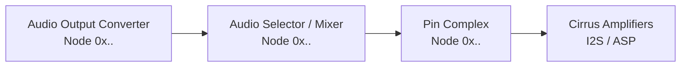

# Codec and Speaker Route Verification

Internal laptop speakers driven by Cirrus smart amplifiers depend on two distinct components working together:

1. **AppleHDA & AppleALC**: Route decoded PCM audio through the onboard HDA codec to its line/speaker output pins.
2. **CirrusAudioFixup**: Configures the external amplifiers over I2C or SPI, uploads DSP firmware, and unmutes the physical speakers.

If AppleALC routes audio to the wrong codec pins, the amplifiers will produce no sound even when initialized successfully (`READY_DSP`).

---

## 1. Check Your Current AppleALC layout-id

In macOS Terminal, run:

```bash
# Check the active layout-id on the audio controller
ioreg -lw0 -p IODeviceTree | grep -E 'layout-id|"alc-layout-id"'
```

The output displays a 4-byte little-endian hexadecimal value:

| Hex Value in IORegistry | Decimal Layout ID (`alcid`) |
| :--- | :--- |
| `<01 00 00 00>` | `1` |
| `<03 00 00 00>` | `3` |
| `<0b 00 00 00>` | `11` |
| `<0d 00 00 00>` | `13` |
| `<0f 00 00 00>` | `15` |
| `<15 00 00 00>` | `21` |
| `<1c 00 00 00>` | `28` |
| `<63 00 00 00>` | `99` |

You can also check if an `alcid` boot argument is currently active:

```bash
nvram 7C436110-AB2A-4BBB-A880-FE41995C9F82:boot-args | grep -o 'alcid=[0-9]*'
```

---

## 2. How to Know if Your layout-id is Correct

Your AppleALC `layout-id` is **correct** for Cirrus smart amplifiers when:

1. **Internal Speakers** appears in **System Settings → Sound → Output**.
2. Audio plays through the laptop speakers (not just headphones).
3. `ioreg -lw0 -p IOService -r -c CirrusAudioFixup` shows:
   * `Cirrus_Driver_Verdict` = `READY_DSP`
   * `Cirrus_Playback_Verdict_left` (or `_right`) = `ACTIVE_REGISTERS_VERIFIED_ROUTE_UNCONFIRMED`

> [!WARNING]
> **Headphones work but Internal Speakers is silent?**
> This is a classic symptom of an incorrect `layout-id`. The current layout routes audio to the 3.5 mm headphone jack, but connects the speaker path to an unused pin.
>
> **Solution**: Test alternative layout IDs supported by your codec model by adding `alcid=<id>` to OpenCore boot-args (e.g., `alcid=11`, `alcid=13`, `alcid=21`). See the [AppleALC Supported Codecs list](https://github.com/acidanthera/AppleALC/wiki/Supported-codecs).

---

## 3. Extract the Linux Codec Dump

If none of the existing AppleALC layout IDs route audio to the internal speakers, extract the physical codec connections from Linux to create or patch an AppleALC layout:

Boot any live Linux USB distribution with working sound, then run:

```bash
mkdir -p ~/codec-dump
for codec in /proc/asound/card*/codec\#*; do
    [ -f "$codec" ] || continue
    card=$(basename "$(dirname "$codec")")
    sudo cat "$codec" > ~/codec-dump/"${card}-$(basename "$codec").txt"
done

# List ALSA audio playback devices
aplay -l > ~/codec-dump/alsa-devices.txt
```

Find the onboard audio codec header:

```bash
grep -HE '^(Codec:|Vendor Id:|Subsystem Id:|Revision Id:)' ~/codec-dump/card*-codec\#*.txt
```

> [!TIP]
> Keep two dumps if possible: one at idle and one while actively playing music through the internal speakers.

---

## 4. Locate AppleALC Resources

In the [AppleALC repository](https://github.com/acidanthera/AppleALC/tree/master/Resources), open the directory corresponding to your codec model (e.g., `Resources/ALC285/` or `Resources/ALC287/`).

Examine the following files:

| File | What to Inspect |
| :--- | :--- |
| `Info.plist` | Layout IDs mapped to your codec subsystem ID. |
| `layout*.xml` | Output channel definitions and `PathMapRef` IDs. |
| `Platforms*.xml` | Ordered signal path nodes (`NodeID`), connections, and amp settings. |

---

## 5. Trace the Signal Path

Trace the signal chain backwards from the amplifier pin to the DAC converter:



Compare the nodes found in your Linux dump against AppleALC:

| Component | Linux Codec Dump Marker | AppleALC XML Field |
| :--- | :--- | :--- |
| **Output Pin** | `Node 0x.. [Pin Complex]` | Pin node connected to amplifier input |
| **Intermediate Controls** | `Node 0x.. [Audio Selector]` / `[Audio Mixer]` | Intermediate `NodeID` in path map |
| **DAC Converter** | `Node 0x.. [Audio Output]` | Primary converter `NodeID` |
| **Connection Selection** | `Connection: 2` with `*` marker | Active path selection |

> [!NOTE]
> Linux codec dumps report node IDs in **hexadecimal** (e.g., `0x17`), while AppleALC XML files use **decimal** integers (e.g., `23`). Make sure to convert between hex and decimal when verifying nodes.

---

## 6. Verify in macOS

Once AppleALC and CirrusAudioFixup are installed:

```bash
# Check detected audio devices
system_profiler SPAudioDataType

# Verify AppleHDA controller attachment
ioreg -lw0 -p IOService -r -c AppleHDAController

# Verify Cirrus amplifier status
ioreg -lw0 -p IOService -r -c CirrusAudioFixup
```

1. Select **Internal Speakers** in macOS Sound Settings.
2. Test audio playback at low volume. Both left and right channels should produce clear sound without distortion.

[Back to main guide](../../README.md#installation)
